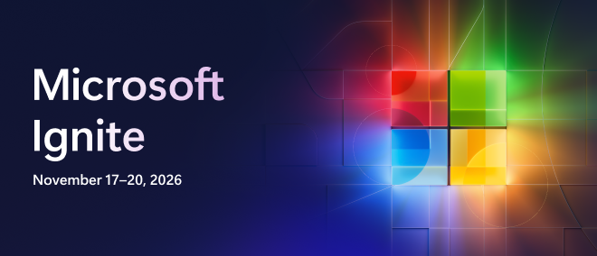

<a name="start-building"></a>

<p align="center">

</p>

# [Microsoft Ignite 2026](https://ignite.microsoft.com)

## 🔥LAB691: Build an AI-ready data foundation with Microsoft OneLake
### Session description

Learn how to unify and govern your data estate with Microsoft OneLake. In this hands-on lab, you'll connect data from multiple sources, explore zero-copy data access patterns, discover and share data across teams, and apply governance controls to create trusted, reusable data assets. Leave with practical skills for preparing data for analytics, AI, and intelligent applications.

### 🚀 Getting started

#### In a guided session

If you're following along during a live session:

1. Open the [attendee instructions](instructions/README.md) and review the prerequisites with your instructor.
2. Locate the included [sample datasets](data/README.md) and open your Fabric workspace.
3. Follow the instructor through the lab, using the [documentation index](docs/README.md) for supporting references.

#### On your own

If you're learning at your own pace:

1. Clone or download this repository.
2. Review the [prerequisites and lab setup](instructions/README.md#prerequisites) and prepare a Fabric workspace with a Lakehouse you can edit.
3. Follow the [attendee instructions](instructions/README.md) from Step 0, using the included [sample datasets](data/README.md), [source files](src/README.md), and [documentation index](docs/README.md).

### 🎯 Learning outcomes

By the end of this session, you will be able to:

- Connect customer data through OneLake shortcuts and transform text feedback with AI-powered sentiment analysis and PII redaction.
- Prepare reusable customer-level Delta tables and segment customers using Spark and Polars.
- Explore customer value, engagement, and retention risk through a Power BI report and an interactive Fabric notebook app.

### 💻 Technologies used

- Microsoft Fabric and OneLake
- Lakehouse, Delta Lake, and SQL analytics endpoint
- OneLake shortcuts and AI-powered shortcut transformations (preview)
- Fabric notebooks with Python (PySpark), Polars, and ipywidgets
- Power BI semantic models and reports

### 📚 Continue your learning

Pick your next step based on your learning style:

| Resource | What you'll get |
|----------|-----------------|
| **[Ignite 2026 Next Steps](https://aka.ms/ignite26-next-steps)** | Additional session repos and materials from Microsoft Ignite 2026 |
| **[Microsoft AI Skills Navigator](https://aka.ms/ignite26-asn)** | Discover AI skills, learning paths, and resources for your next step |
| **[Microsoft Learn](https://aka.ms/ignite26-learn)** | Official documentation and guided learning paths on these topics |
| **[Microsoft Foundry Community](https://aka.ms/MicrosoftFoundryDiscord-Ignite26)** | Connect with other learners and experts in our Discord community |

### 🌟 Microsoft Learn MCP server (optional)

The Microsoft Learn MCP Server gives your AI agent direct access to Microsoft's official documentation — grounded, up-to-date answers about the topics in this session.

**GitHub Copilot CLI** — Install with:

```shell
copilot plugin install microsoftdocs/mcp
```

**VS Code** — One-click install:  
[](https://vscode.dev/redirect/mcp/install?name=microsoft-learn&config=%7B%22type%22%3A%22http%22%2C%22url%22%3A%22https%3A%2F%2Flearn.microsoft.com%2Fapi%2Fmcp%22%7D)

For more information, visit the [Learn MCP Server repo](https://aka.ms/learnmcp).

### 👥 Content owners

<table>
<tr>
    <td align="center"><a href="https://github.com/rhasson">
        <br />
        <sub><b>Roy Hasson</b></sub></a><br />
            <a href="https://github.com/rhasson" title="talk">📢</a>
    </td>
</tr></table>

### ⚖️ Trademarks

This project may contain trademarks or logos for projects, products, or services. Authorized use of Microsoft trademarks or logos is subject to and must follow [Microsoft's Trademark & Brand Guidelines](https://www.microsoft.com/legal/intellectualproperty/trademarks/usage/general). Use of Microsoft trademarks or logos in modified versions of this project must not cause confusion or imply Microsoft sponsorship.

Any use of third-party trademarks or logos are subject to those third-party's policies.
